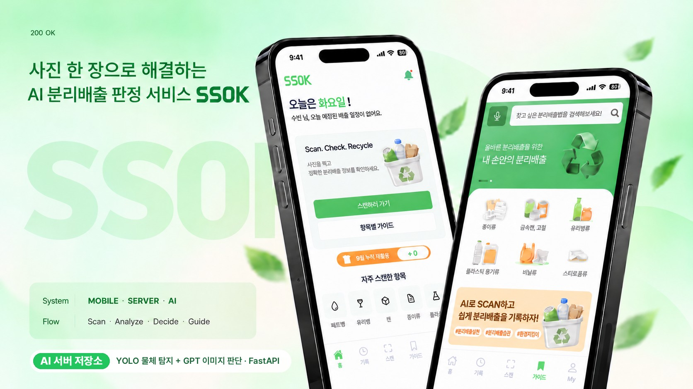
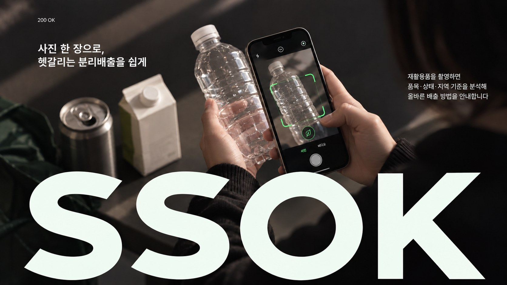
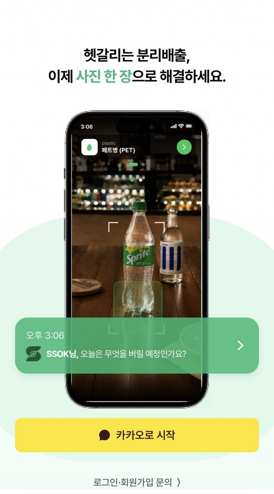
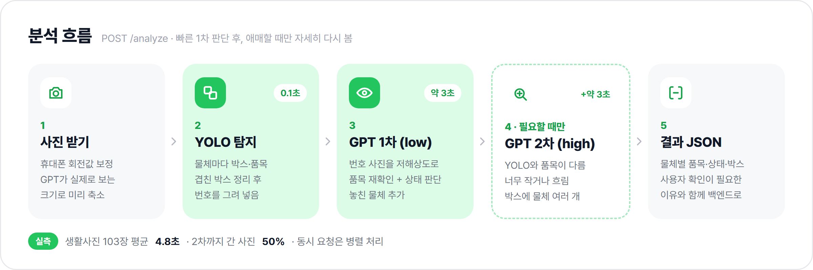
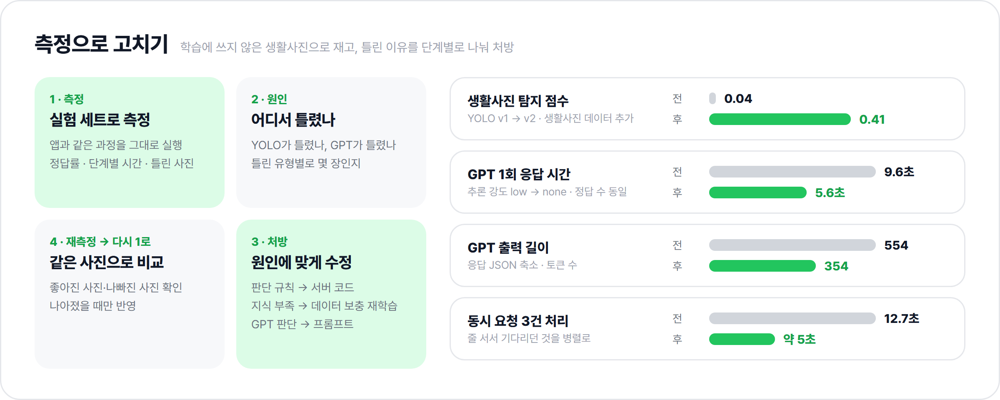
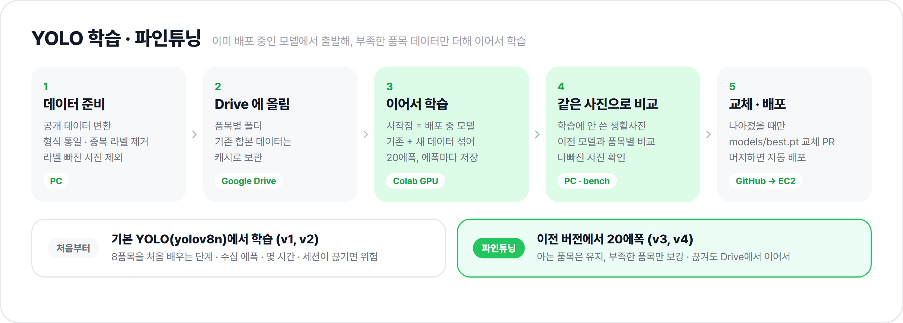
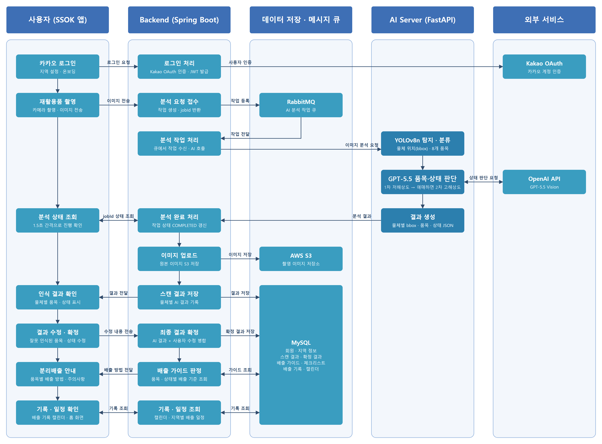
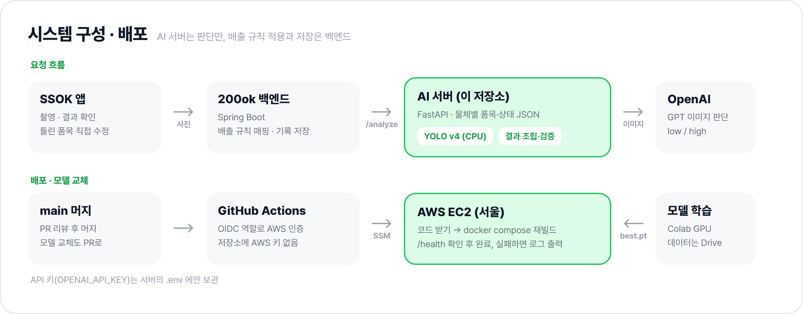

<p align="center">
  
</p>

# SSOK AI 서버

[](https://github.com/200ok-Hongik/200ok-AI/actions/workflows/deploy-ai-ec2.yml)

> 사진 한 장으로 재활용품을 찾아 품목을 나누고, 분리배출에 필요한 상태까지 판단하는 분석 서버

- 홍익대학교 졸업프로젝트 · 팀 200ok
- 서비스: [ssok.store](https://ssok.store) · 앱 저장소 [200ok-FE](https://github.com/200ok-Hongik/200ok-FE) · 백엔드 저장소 [200ok-BE](https://github.com/200ok-Hongik/200ok-BE)
- API 상세 명세·응답 예시: [recycle-ai-server/README.md](recycle-ai-server/README.md)

## 목차
1. [하는 일](#하는-일)
2. [분석 흐름](#분석-흐름)
3. [기술적으로 고민한 점](#기술적으로-고민한-점)
4. [측정으로 고치기](#측정으로-고치기)
5. [YOLO 모델 이력](#yolo-모델-이력)
6. [학습 데이터 품질 관리](#학습-데이터-품질-관리)
7. [시스템 구성 · 배포](#시스템-구성--배포)
8. [API](#api)
9. [실행 방법](#실행-방법)
10. [진행 중 · 향후 계획](#진행-중--향후-계획)
11. [폴더 구조](#폴더-구조)

---

## 하는 일

<p align="center">
  
</p>

<table>
<tr>
<td width="34%" align="center"></td>
<td>

**앱에서 하는 일**
1. 재활용품을 카메라로 촬영
2. 백엔드가 이 AI 서버에 사진 분석 요청
3. AI 서버가 물체별 품목·상태를 판단해 응답
4. 앱이 결과를 보여 주고, 틀린 부분은 사용자가 직접 수정
5. 백엔드가 품목·상태·지역 기준으로 배출 방법 안내

**AI 서버가 맡는 부분: 2 → 3**

</td>
</tr>
</table>

- 사진 속 재활용품을 **하나씩** 찾아 번호를 매김 (사진 한 장에 여러 개 가능)
- 물체마다 8개 품목 중 하나로 분류, 품목에 맞는 **상태**까지 판단
- 확신이 없으면 이유를 붙여 "사용자 확인 필요"로 표시 → 앱에서 사용자가 직접 수정
- 배출 규칙 적용·기록 저장은 백엔드 담당, 이 서버는 **판단만**

| 품목 코드 | 품목 | 판단하는 상태 |
|---|---|---|
| `CLEAR_PET_BOTTLE` | 무색 투명 페트병 (별도 배출) | 투명 여부, 라벨, 비었는지, 뚜껑, 오염, 찌그러짐 |
| `PLASTIC` | 유색 페트·플라스틱 용기 | 투명 여부, 라벨, 비었는지, 뚜껑, 오염, 찌그러짐 |
| `CAN` | 캔·금속캔 | 오염, 찌그러짐 |
| `GLASS_BOTTLE` | 유리병 | 라벨, 뚜껑, 비었는지, 오염, 깨짐 |
| `VINYL` | 비닐·필름 포장재 | 비었는지, 오염 |
| `PAPER` | 종이·박스·종이컵 | 오염, 젖음, 테이프, 펼침 |
| `PAPER_PACK` | 종이팩·우유팩 | 뚜껑, 빨대, 오염, 펼침 |
| `STYROFOAM` | 스티로폼 | 라벨, 테이프, 오염 |
| `UNKNOWN` | 8품목 밖 물체 (빨대, 나무젓가락 등) | 사용자가 품목 선택 |

- 품목·상태 목록은 팀 "규칙 수집" 최종안 기준 (`schemas/analysis_schema.py`)
- 종이컵은 환경부 분리배출 기준(골판지 외 종이류)에 따라 `PAPER`

---

## 분석 흐름

<p align="center">
  
</p>

1. **사진 받기** — 휴대폰 회전값(EXIF) 보정, GPT가 실제로 보는 크기(긴 변 2048px)로 미리 축소해 업로드 시간 단축
2. **YOLO 탐지** — 물체마다 박스·품목, 겹친 박스 정리 후 원본 사진 위에 번호를 그려 넣음
3. **GPT 1차 (low)** — 번호 사진을 저해상도로 보여 주고 번호별 품목 재확인 + 상태 판단, YOLO가 놓친 물체 추가
4. **GPT 2차 (high, 필요할 때만)** — 아래 경우에만 같은 사진을 고해상도로 다시 판단
   - YOLO와 GPT의 품목이 다름 / 물체가 너무 작거나 흐림 / 박스 하나에 물체 여러 개 / 위치를 모르는 추가 물체
5. **결과 JSON** — 물체별 품목·상태·박스, 확인이 필요한 이유(`review`)와 함께 백엔드로

- 실측(생활사진 103장, 2026-11-24): 사진당 평균 **4.8초**, 2차까지 간 사진 50%
- GPT 추론 강도(`OPENAI_REASONING_EFFORT`)와 이미지 해상도 단계(low/high)는 별개 설정 — 추론은 1·2차 모두 `none`

---

## 기술적으로 고민한 점

**1. 빠른 1차 판단 + 애매할 때만 2차** — `result_builder.should_reanalyze_high`
- 처음엔 거의 모든 사진이 2차까지 가서 분석 시간이 약 2배 → 품목·위치에 영향이 있는 경우만 2차로 좁힘
- 상태값 하나가 애매한 정도는 2차 대신 "사용자 확인"으로 넘김 (앱에서 직접 수정 가능)

**2. 응답 속도 줄이기** — 측정 후 하나씩 적용
- GPT 출력 JSON을 한 줄·필요한 필드만으로 축소: 출력 토큰 554 → 354
- 추론 강도 low → none: GPT 1회 9.6초 → 5.6초 (생활사진 72장에서 품목 정답 수 동일 확인 후 적용)
- 동시 요청: YOLO·GPT 호출을 스레드로 넘겨 병렬 처리, YOLO 모델은 잠금으로 보호 → 3건 동시 12.7초 → 약 5초

**3. YOLO와 GPT의 역할 나누기**
- YOLO: 빠르게 위치를 잡는 역할 (0.1초, CPU)
- GPT: 사진 전체를 보고 품목 재확인·상태 판단·놓친 물체 추가
- GPT 결과는 서버가 다시 정리 — 8품목 밖 코드(`can`, `BATTERY` 등)는 대문자 8품목 또는 `UNKNOWN`으로, GPT가 번호 물체를 빠뜨리면 YOLO 결과로 복원

**4. GPT가 지어내지 않게** — `prompts/pet_bottle_prompt.py`
- "보이는 것만 판단, 애매한 상태는 null" 규칙
- 같은 물체를 재질별로 두 번 적지 않기 (종이컵 → 종이 + 플라스틱 2개로 나오던 문제)
- 책상·바닥·손 같은 배경은 적지 않기, 컵 안의 빨대처럼 떼어 버리는 물체는 따로 적기
- 응답 예시를 빈 배열로 → 예시를 따라 없는 물체를 만들어 내던 문제 해결

**5. 생활사진에서도 동작하는 YOLO** — [YOLO 모델 이력](#yolo-모델-이력)
- 첫 모델은 선별장(컨베이어) 사진으로만 학습 → 실제 앱 사진은 거의 못 잡음(생활사진 점수 0.04)
- 공개 생활사진 데이터를 8품목 형식으로 변환해 보충 → 0.41

---

## 측정으로 고치기

<p align="center">
  
</p>

- `bench/benchmark.py`: 실제 `/analyze` 코드를 그대로 돌려 단계별 시간·GPT 호출 수·토큰·정답률 기록, `--compare` 로 두 결과 비교
- 학습에 쓰지 않은 생활사진으로 실험 세트를 만들고, 정답 라벨은 사진을 직접 보고 검수
- 틀린 사진은 **어느 단계에서 틀렸는지** 나눠 처방
  - 예: 103장 중 오답 37장 → YOLO 단계 29장 · GPT 단계 5장 · 기타 3장
  - YOLO 판단 규칙 문제(같은 물체를 여러 번 잡음) → 서버 코드
  - YOLO 지식 부족(스티로폼을 종이로, 비닐 혼동) → 그 품목 데이터 보충 재학습
  - GPT 판단 문제 → 프롬프트

---

## YOLO 모델 이력

| 버전 | 시기 | 학습 데이터 변화 | 계기 · 결과 |
|---|---|---|---|
| v1 | 2026-09 | AIHub 선별장 사진, 8품목을 **한 모델**로 통합 | 품목마다 모델을 돌리면 품목 수만큼 느려짐. 선별장 검증 mAP50 0.875 |
| v2 | 2026-11 | + 공개 생활사진(TACO), 종이·종이팩, 물체 없는 배경 사진 | 실제 앱 사진을 거의 못 잡음 → 생활사진 0.04 → 0.41, 선별장 0.86 유지 |
| v3 | 2026-11-13 | + 종이컵 294장 (`PAPER`) | 종이컵을 종이팩으로 오분류 → 해결. v2 에서 이어서 학습 |
| v4 (배포 중) | 2026-11-24 | + 스티로폼 1,092장 · 비닐 962장 · 유리병 609장 (한국 생활 환경 위주) | 실험 세트 분석에서 스티로폼→종이, 비닐 혼동이 주요 오류 → 생활사진 0.371 → 0.398, 선별장 0.850 → 0.847 유지, 앱과 같은 과정 품목 정답 67 → 72/103 |

### 파인튜닝 (v3 부터)

<p align="center">
  
</p>

- **파인튜닝**: 빈 상태가 아니라 **이미 배포 중인 모델의 가중치를 출발점**으로, 부족한 품목 데이터를 더해 짧게 이어서 학습
  - v1·v2: 기본 YOLO(yolov8n)에서 8품목을 처음부터 학습 (수십 에폭, 몇 시간)
  - v3·v4: 이전 버전(v2 → v3, v3 → v4)에서 20에폭만 이어서 학습
- **왜**: Colab 세션이 20분~1.5시간마다 끊겨 몇 시간짜리 학습은 중간에 날아감 + 이미 잘 아는 품목(캔·페트 등)을 처음부터 다시 배울 필요 없음
- **기존 데이터도 섞어서**: 새 품목 데이터만 학습하면 이전에 알던 품목을 잊어버림(catastrophic forgetting) → 합친 데이터 전체로 학습
- **끊겨도 이어서**: 합친 데이터셋 ZIP 과 에폭마다 중간 저장본(`last.pt`)을 Drive 에 보관 → 새 세션에서 50분짜리 다운로드 없이 바로 재개
- 스크립트: `training/train_yolo.py` (`START_WEIGHTS` = 출발 모델, `FINETUNE_EPOCHS` = 20 · main 에는 v1 버전, v2 이후 버전은 main 반영 준비 중)
- 교체: 같은 실험 세트로 이전 버전과 비교 → 나아졌을 때만 `models/best.pt` 교체 PR, 되돌리기는 PR revert

---

## 학습 데이터 품질 관리

공개 데이터를 그대로 쓰지 않고 아래 순서로 정리 (v2·v3 데이터에 적용, 변환 스크립트 `training/convert_roboflow.py`·`convert_taco.py` 는 main 반영 준비 중)

- **형식 통일**: 데이터마다 다른 클래스 이름("glassbottle" 등)·윤곽선(폴리곤) 라벨을 8품목 이름·사각형 박스(YOLO 형식 `클래스 중심x 중심y 너비 높이`)로 변환
- **애매한 클래스 처리**: 8품목인지 애매한 클래스가 있는 사진은 통째로 제외, 8품목 밖 물체는 박스만 제거
- **품질 필터**: 박스가 너무 많은 더미 사진, 사진 전체를 덮는 질감 사진, 미리 회전된(모서리가 검은) 사진 제외
- **출처 기록**: 변환 폴더마다 `source.txt`(출처 URL·라이선스)와 `convert_report.json`(제외 수·사유)

진행 중 보강은 [진행 중 · 향후 계획](#진행-중--향후-계획) 참고

---

## 시스템 구성 · 배포

**서비스 전체 흐름** (앱 · 백엔드 · AI 서버)

<p align="center">
  
</p>

- 백엔드가 분석 요청을 작업 큐(RabbitMQ)에 넣고 바로 응답 → 앱은 작업 상태를 조회해 결과 확인
- AI 서버는 이미지 분석만, 배출 규칙 판정·사진 저장(S3)·기록(MySQL)은 백엔드

**AI 서버 구성 · 배포**

<p align="center">
  
</p>

| 구분 | 기술 |
|---|---|
| 서버 | Python, FastAPI, Uvicorn |
| 탐지 모델 | Ultralytics YOLOv8 (8품목, CPU 추론) |
| 이미지 판단 | OpenAI GPT (gpt-5.5, Responses API) |
| 실행 환경 | Docker Compose, AWS EC2 (서울) |
| CI/CD | GitHub Actions — main 머지 시 OIDC 인증 → SSM 으로 EC2 에서 재빌드 → `/health` 확인 |
| 학습 | Colab GPU, Google Drive (서비스 계정으로 데이터 읽기) |

- 저장소에 AWS 키 없음 (GitHub OIDC 역할), `OPENAI_API_KEY` 는 서버 `.env` 에만 보관
- 배포 문서: [recycle-ai-server/DEPLOY.md](recycle-ai-server/DEPLOY.md)

---

## API

| 메서드 | 경로 | 설명 |
|---|---|---|
| GET | `/health` | 서버 상태 |
| POST | `/analyze` | 사진 분석 (multipart `image`) → 물체별 품목·상태·박스 |
| POST | `/analyze-ai2` | 단일 물체 분석 (이전 방식, 호환용) |
| POST | `/debug-yolo` | YOLO 탐지 결과만 확인 (개발용) |

- 응답 형식·`resultSource`·`review.status` 값: [recycle-ai-server/README.md](recycle-ai-server/README.md)

---

## 실행 방법

```bash
cd recycle-ai-server
python -m pip install -r requirements.txt
cp .env.example .env        # OPENAI_API_KEY 입력
python -m uvicorn main:app --reload --host 0.0.0.0 --port 8010
```

- 확인: http://localhost:8010/health , http://localhost:8010/docs
- Docker: `docker compose up -d --build` (포트 8000)
- 테스트: `python -m pytest -q` (GPT 호출 없이 가짜 응답으로 동작)
- 속도·정답률 측정: `python bench/benchmark.py --label <이름>` (실제 GPT 호출, 비용 발생)

---

## 진행 중 · 향후 계획

**진행 중 (main 반영 전)**
- v2 이후 학습 스크립트·공개 데이터 변환 스크립트 정리 후 반영
- 같은 품목 중복 박스 합치기 — 같은 품목 박스가 다른 박스 안에 85% 이상 들어가면 하나로 (종이 1장이 2~3개로 나오던 문제, 생활사진 416장에서 헛박스 134 → 117)
- 데이터 정제 보강
  - 중복 라벨 제거: 같은 물체를 사각형·윤곽선으로 두 번 적은 데이터 → 하나로 (스티로폼 약 2,600줄 → 1,313개)
  - 라벨 빠진 사진 제외: 다른 품목이 찍혔는데 라벨이 없으면 모델이 "그건 배경"으로 잘못 배움 → 현재 모델로 찾아 제외
  - 증강 복사본(같은 원본을 돌리거나 밝기만 바꾼 사진)을 학습·검증에 나눠 넣지 않기
- 실험 세트를 여러 개 두고 반복 측정 (`benchmark.py --set`)
- GPT 에 YOLO 품목 힌트를 주는 방식 비교 — 힌트를 그대로 따라가는 경우가 있어 full / soft / hidden 실험 중

**향후 계획**
- 쓰레기가 아닌 물건(쓰레기통·가구) 결과에서 제외
- 사용자가 앱에서 고친 결과를 모아 다음 학습 데이터로 사용
- 촬영 안내(물건 하나·밝게·가까이) — 앱과 협의

---

## 폴더 구조

```
recycle-ai-server/
├── main.py                     FastAPI 엔드포인트 (/analyze 흐름)
├── services/
│   ├── yolo_service.py         YOLO 탐지, 중복 박스 정리, 번호 그리기
│   ├── openai_vision_service.py  GPT 호출, 이미지 축소, 응답 정리
│   └── result_builder.py       결과 조립, 2차 재분석 조건, 사용자 확인 이유
├── prompts/pet_bottle_prompt.py  GPT 프롬프트 (8품목·상태 기준)
├── schemas/analysis_schema.py  품목별 상태 항목, 품목 코드 정리
├── training/                   YOLO 학습(Colab) 스크립트·실행 노트
├── bench/                      속도·정답률 측정 도구
├── tests/                      pytest
└── models/best.pt              배포 중인 YOLO 모델
docs/assets/                    README 그림 (원본 src/*.html, scripts/render-readme-images.sh 로 생성)
```
